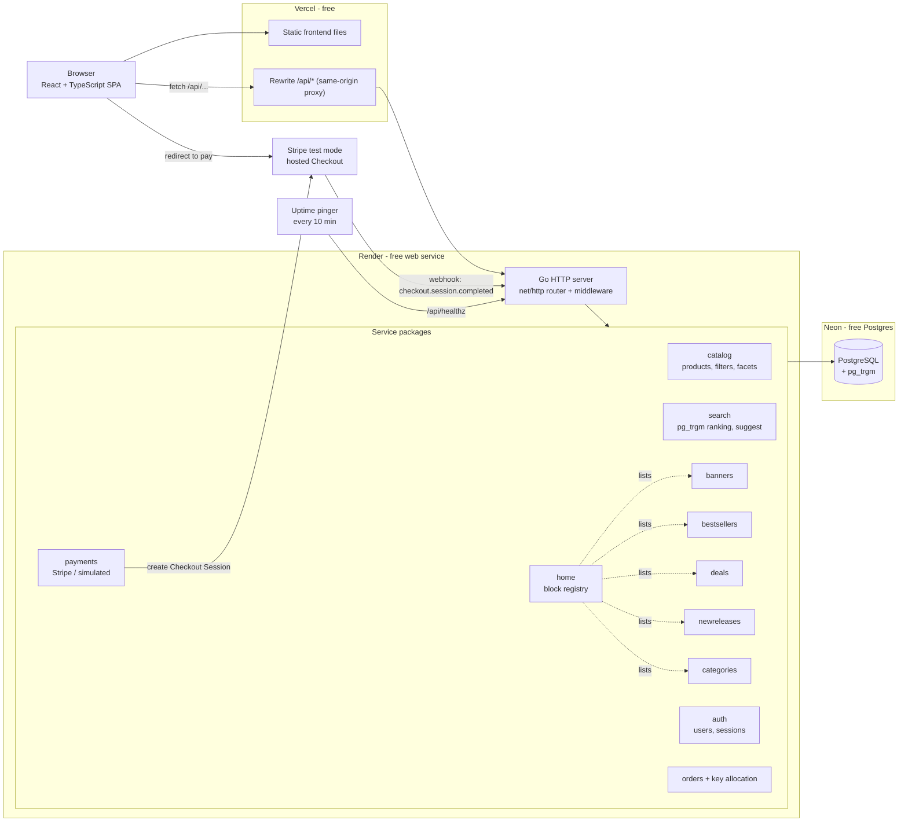
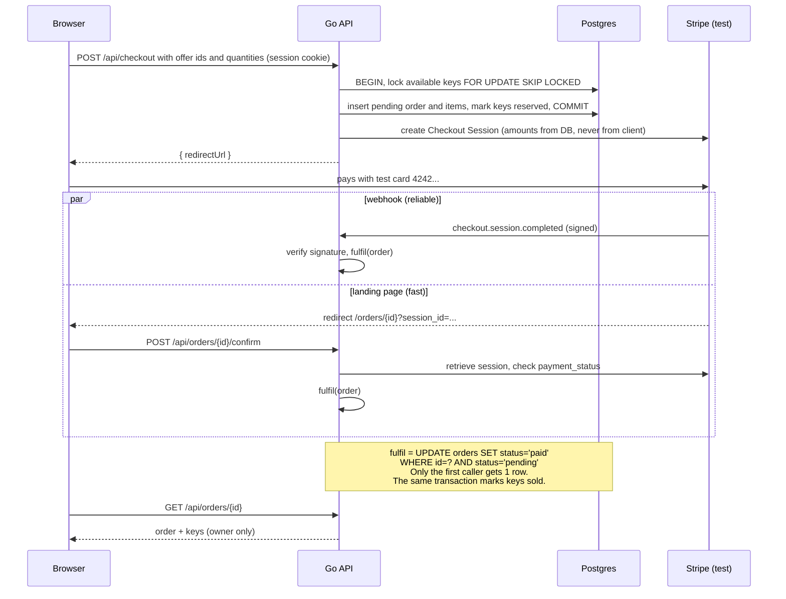
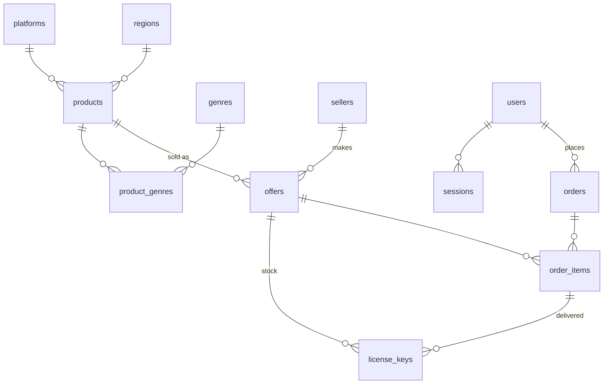

# PLAN — Eneba Intern Assignment 2027

Planning document written on 2026-11-16 in the setup session (day 1), before any application code.
Background material: [`docs/requirements.md`](docs/requirements.md) (requirement IDs F1…, V1…),
[`docs/research.md`](docs/research.md) (facts, sources, reasoning),
[`docs/design-reference.md`](docs/design-reference.md) (UI), [`docs/tooling.md`](docs/tooling.md).

> Status: **approved by the author on 2026-11-16** (day 1 of 7). The author's answers to the open
> questions are recorded in §10 and already applied throughout this document.

---

## 1. Scope decision

The brief: *"A few features done extensively beat many fitting minimal requirements."*
Every required part will **exist and work**, but the effort is deliberately uneven.

### Go deep (≈ 75% of the effort)

**A. Search + store catalog** (F1–F4, F8–F11)
- Typo-tolerant, partial-name search in Postgres (`pg_trgm`) with a designed, tested ranking.
- Header search available on every page: instant dropdown with product hits, Enter → store page.
- Store filters (platform, region, genre, price range) **with live counts**, sorting, pagination.
- All state in the URL (`/store?text=witchr&platform=steam&sort=price_asc`) — shareable, back
  button works, page reload keeps the filters.
- *Why deep:* it is the first thing a visitor touches, it is three of the seven listed parts, and
  it is the feature Eneba's own site does best. It also shows real SQL and API design.

**B. Offers: compare sellers, then buy without double-selling a key** (F12–F16, F21)
- *Author's scope adjustment:* the product page is **not** minimal. Offers from several sellers are
  the core of a marketplace, and checkout buys one specific offer, so the offer model is built
  anyway — it should be shown properly.
- Product page with a real **offer comparison**: one row per seller showing price (and discount
  against the reference price), seller name, seller rating, region, and stock ("In stock",
  "Only 2 left", "Sold out"). The **cheapest in-stock offer is highlighted** ("Best price") and is
  also the one in the buy box; rows can be sorted by price or seller rating; sold-out offers are
  shown but cannot be added to the cart.
- The cart holds *offers* (seller + price), not products, exactly like Eneba's cart ("Sold by …").
- Pre-loaded key stock per offer; keys reserved inside a transaction (`FOR UPDATE SKIP LOCKED`).
- Stripe Checkout in test mode, signature-verified webhook, idempotent fulfilment, the success
  page also triggers fulfilment (as Stripe recommends); simulated provider as fallback.
- Automated tests that *prove* it: N concurrent buyers for the last key → exactly one succeeds;
  the same webhook delivered twice → one key, one order.
- *Why deep:* this is the core risk of a real key marketplace (money + inventory + concurrency),
  and correctness here is something I can demonstrate and explain, not just show.

**C. Eneba look and feel + backend-driven homepage** (F5–F7, F20)
- Design tokens taken from measured values (`docs/design-reference.md`), a small set of shared
  components (Button, ProductCard, OfferRow, Badge, FilterGroup…) used on every screen.
- Homepage rendered entirely from backend data: the list of blocks *and* each block's content.
- *Why deep:* "matches eneba.com" is in the first sentence of the task, and V1/V2 is the most
  unusual architectural requirement in the brief.

### Keep minimal (but complete)

| Part | What is built | What is deliberately left out |
|---|---|---|
| Authentication (F17–F19) | Register, sign in, sign out, session cookie, protected checkout + order history | E-mail verification, password reset, social login, 2FA, profile page |
| Product page — details part (F12) | Title, cover, description, platform/region info tiles, genres, release date, developer/publisher (the **offers** part of the page is deep, see B) | Reviews, image gallery, system requirements, "also viewed" |
| Order history (F19) | List of orders, order page with purchased keys | Refunds, invoices, e-mailing keys |
| Cart (F14) | Browser-stored cart (works before sign-in), quantities, server re-validates price and stock at checkout | Server-side cart sync across devices |

### Out of scope (stated in the README)
Seller dashboard and admin UI, wishlist, cashback/loyalty, multiple currencies and languages,
discount codes, real e-mails, mobile app-level polish. Sellers, offers and key stock are seeded.

### Catalog data (author's decision)
- Game data comes from the **Steam store**, fetched **once** by a seed script and stored in our
  own database. **The running app never calls Steam.** Cover images are hot-linked from Steam's
  CDN (only the URL is stored). The data source is credited in the README.
- Two steps, so seeding is repeatable and does not depend on Steam being reachable:
  1. `fetch` — reads a hand-picked list of Steam app IDs, downloads their public store details
     and writes a JSON snapshot that is committed to the repo (`backend/seed/steam_games.json`);
  2. `seed` — loads the snapshot into Postgres and **generates** what Steam does not have:
     region variants, sellers, offers (prices as discounts from Steam's price) and license keys,
     using a fixed random seed so every run produces the same data.
- Honest labelling in the README: titles, descriptions, genres, dates and covers are real Steam
  data; sellers, prices, stock, keys and any non-Steam platform variants are synthetic demo data.
- To verify on day 2 before relying on it: the exact Steam endpoint, its rate limit, and the
  portrait cover URL pattern.

---

## 2. Architecture

**Request path:** the browser only ever talks to the Vercel domain. `/api/*` is proxied to Render,
so the session cookie is first-party and no CORS setup is needed.

**Backend layering** (same in every package, so the code is predictable):
`handler` (HTTP ↔ JSON, validation) → `service` (business rules) → `repository` (SQL via pgx).
Dependencies are passed in explicitly in `main.go` — no framework, no global state.

**Homepage contract (V1/V2):**
1. `GET /api/home` → ordered list from the `home_blocks` table:
   `[{ "id": 1, "type": "banner", "title": null, "source": "/api/home/banners" }, { "type": "product_carousel", "title": "Best sellers", "source": "/api/home/best-sellers", "showAllUrl": "/store?sort=popular" }, …]`
2. The frontend has a map *block type → React component* and nothing else; for each block it
   fetches `source` independently (own loading skeleton, own error state).
3. Each `source` is served by its own Go service with its own data source:

| Block | Service | Where the data comes from |
|---|---|---|
| Banner | `banners` | `banners` table (curated content: image, link, order) |
| Best sellers | `bestsellers` | aggregated from `order_items` (real purchases in the app; seeded history) |
| Deals | `deals` | computed from `offers`: biggest discount vs. original price |
| New releases | `newreleases` | `products.release_date` |
| Categories | `categories` | `genres` + live product counts |

**Purchase sequence (the deep part B):**

Unpaid orders: reservation expires (Stripe `checkout.session.expired` webhook and a lazy clean-up
when stock is read) → keys return to `available`.

---

## 3. Data model

Money is stored as **integer cents** (no floating point). All tables have `id bigserial` and
`created_at timestamptz` unless noted.

| Table | Main columns | Notes |
|---|---|---|
| `platforms` | `slug`, `name` | Steam, Xbox Live, PSN, Nintendo, GOG, Epic… |
| `regions` | `slug`, `name` | Global, Europe, United States… |
| `genres` | `slug`, `name` | Action, RPG, Strategy… |
| `products` | `slug` (unique), `name`, `description`, `product_type`, `platform_id` → platforms, `region_id` → regions, `cover_url`, `release_date`, `developer`, `publisher`, `popularity`, `steam_app_id` | One row = one sellable variant (title + platform + region), like Eneba. **GIN trigram index on `name`**. `steam_app_id` records where the data came from and groups the variants of the same game. |
| `product_genres` | `product_id`, `genre_id` | many-to-many |
| `sellers` | `name`, `rating` (0–10), `rating_count`, `is_verified` | seeded; shown in the offer comparison |
| `offers` | `product_id` → products, `seller_id` → sellers, `price_cents`, `original_price_cents`, `is_active` | unique (`product_id`, `seller_id`). Discount % is derived. |
| `license_keys` | `offer_id` → offers, `key_value`, `status` (`available`/`reserved`/`sold`), `order_item_id` → order_items (nullable), `reserved_until` | One row per key. Stock of an offer = count of `available`. Partial index on (`offer_id`) where `status='available'`. |
| `users` | `email` (unique, lower-cased), `password_hash` | Argon2id |
| `sessions` | `user_id` → users, `token_hash` (unique), `expires_at` | cookie holds the raw token; DB only its SHA-256 |
| `orders` | `user_id` → users, `status` (`pending`/`paid`/`expired`), `total_cents`, `currency`, `payment_provider`, `provider_session_id` (unique), `paid_at` | |
| `order_items` | `order_id` → orders, `offer_id` → offers, `product_name`, `seller_name`, `unit_price_cents`, `quantity` | name and price are **snapshots** so history stays correct if an offer changes |
| `payment_events` | `provider`, `event_id` (unique), `type`, `payload` | every webhook received; audit trail and duplicate detection |
| `banners` | `title`, `subtitle`, `image_url`, `link_url`, `sort_order`, `is_active` | homepage banner block |
| `home_blocks` | `type`, `title`, `source`, `show_all_url`, `sort_order`, `is_active` | homepage layout |

A SQL view `product_listing` (product + cheapest in-stock offer price + offer count) feeds the
store, search and carousels so "From €X" is computed in one place.

**Region in the offer comparison.** As on Eneba, region belongs to the *product* (a "Europe" key
and a "Global" key are different products with different URLs), so every offer on one product
page has the same region. The offer row still shows it, because it tells the buyer where that key
activates. To make region a real comparison, the page also gets an "Other versions" strip: the
same game (`steam_app_id`) in other regions/platforms with each version's cheapest price, linking
to that product's page. *(Alternative considered: put the region on the offer instead of the
product. Rejected because the region filter and the product URL would stop matching Eneba's model.)*

---

## 4. API (REST, JSON, all under `/api`)

| Method & path | Auth | Purpose |
|---|---|---|
| `GET /healthz` | – | liveness (also used by the uptime pinger) |
| `GET /home` | – | ordered list of homepage blocks |
| `GET /home/banners` | – | banner block data |
| `GET /home/best-sellers` | – | product cards |
| `GET /home/deals` | – | product cards |
| `GET /home/new-releases` | – | product cards |
| `GET /home/categories` | – | genres with counts |
| `GET /products` | – | store: `text`, `platform`, `region`, `genre`, `type`, `price_min`, `price_max`, `sort`, `page` → `{items, total, page, facets}` |
| `GET /search/suggest?q=` | – | header dropdown: top product hits for a partial/misspelled query |
| `GET /products/{slug}` | – | product details + all offers (price, reference price, seller name, seller rating, region, stock level, `isCheapest`) + other versions of the same game |
| `POST /auth/register` | – | create account, start session |
| `POST /auth/login` | – | start session (sets cookie) |
| `POST /auth/logout` | ✔ | end session |
| `GET /auth/me` | – | current user or `null` |
| `POST /cart/validate` | – | given `[{offerId, quantity}]` return current names, prices, availability (cart lives in the browser) |
| `POST /checkout` | ✔ | create order, reserve keys, return payment redirect URL |
| `POST /webhooks/stripe` | signature | Stripe events → fulfil / expire |
| `POST /orders/{id}/confirm` | ✔ owner | landing-page fulfilment trigger |
| `POST /payments/simulated/{orderId}` | ✔ owner | only when the simulated provider is enabled |
| `GET /orders` | ✔ | order history |
| `GET /orders/{id}` | ✔ owner | order with items and (if paid) keys |

Errors use one JSON shape `{ "error": { "code": "out_of_stock", "message": "…" } }` and proper
status codes (400 validation, 401 not signed in, 403 not yours, 404, 409 conflict/out of stock).

---

## 5. Tech stack and why

| Layer | Choice | Why (short; details in `docs/research.md`) |
|---|---|---|
| Frontend | React 19 + TypeScript + Vite | Required/preferred by the brief; Vite is the standard fast build tool. |
| Routing | React Router | De-facto standard; URL-driven store filters need a router. |
| Server data | TanStack Query | Caching, loading/error states and retries per request — exactly what independent homepage blocks need — without hand-written `useEffect` fetching. |
| Styling | Tailwind CSS v4 with tokens from `docs/design-reference.md` (`@theme`) + Metropolis font via `@fontsource/metropolis` | One place for the palette/spacing; classes sit next to the markup, so a component can be read top to bottom. |
| Client state | React context + `localStorage` for the cart | Small enough that Redux/Zustand would be overkill. |
| Backend | Go (latest stable), standard library `net/http` | Typed, compiled, explicit — close to C#/C++ habits; no framework magic to explain; tiny fast-starting binary for a sleeping free tier. |
| DB driver | `pgx` v5 + hand-written SQL | The SQL *is* the interesting part (search, facets, locking); nothing hidden by an ORM. |
| Migrations | plain `.sql` files run by `goose` (embedded, run at start-up) | Schema history in the repo; no manual DB steps on deploy. |
| Database | PostgreSQL on Neon — `main` branch for production, `dev` for local development, `test` for automated tests | Free without the 30-day expiry of Render Postgres; supports `pg_trgm`. A Neon branch is a separate copy of the database, so nothing (no Docker, no local Postgres) has to be installed. |
| Seed data | Go seed command: Steam store → committed JSON snapshot → Postgres | Real-looking catalog; the app itself never calls Steam (see §1). |
| Search | `pg_trgm` | Typo tolerance without a second service to host and sync. |
| Auth | Server-side sessions, httpOnly cookie, Argon2id | Simple to reason about and revoke; follows OWASP guidance. |
| Payments | Stripe Checkout (test mode) via `stripe-go`; simulated provider behind the same interface, chosen with the `PAYMENT_PROVIDER` env var; Stripe CLI forwards webhooks to localhost during development | Real asynchronous payment flow, no card data on our server; fallback keeps the demo working. |
| Hosting | Vercel (frontend) + Render (Go, Docker) + Neon | All free, all card-less; Vercel and Render are named in the brief. |
| CI | GitHub Actions: `go vet`, `go test`, `tsc`, ESLint, Vitest | Every push is checked; Postgres service container for integration tests. |

---

## 6. Seven-day plan

Seven days in total, **starting 2026-11-16** (the author tracks the exact deadline). Day 1 was the
setup session, so six days remain for building. Each day ends with: working deploy, small commits
pushed, exported AI log, a few lines in `docs/journal.md` about what was decided and why.

| Day | Date | Goal | Main tasks | Done when |
|---|---|---|---|---|
| **1** ✔ | Nov 16 | Setup, research, plan | Logging hook, requirements checklist, eneba.com design reference, research, tooling, this plan | Done |
| **2** | Nov 17 | Skeleton deployed end to end + data | Monorepo (`frontend/`, `backend/`); Go server with `/api/healthz`; Vite + Tailwind app that calls it; first migration on Neon; **deploy to Render + Vercel + rewrite**; verify the cookie round-trip through the rewrite; GitHub Actions; uptime pinger; full schema; Steam fetch script + seed script; design tokens, header/footer shell | Public URL shows seeded products that came from Neon through Go |
| **3** | Nov 18 | Store + search (deep A) | `GET /products` with filters, sorting, pagination, facet counts; `ProductCard`, `Button`, `Badge`, filter sidebar; store page with URL state; `pg_trgm` index, ranking query, table-driven tests with typo/partial queries; `/search/suggest`; header search dropdown | Store looks like screenshot 08; `witchr 3`, `mincraft`, `gta` find the right products; tests green |
| **4** | Nov 19 | Product page with offer comparison, cart, auth (deep B, part 1) | `GET /products/{slug}` with offers, seller rating and stock; offer comparison UI (cheapest highlighted, sorting, sold-out state), buy box; cart (localStorage, validate endpoint, cart page, add-to-cart modal); register/login/logout, sessions, protected routes | Can compare sellers, sign up and fill a cart on the deployed site |
| **5** | Nov 20 | Checkout and key delivery (deep B, part 2) | Orders + key reservation transaction; `PaymentProvider` interface; simulated provider first, then Stripe Checkout + webhook + confirm endpoint; order page with keys; order history; concurrency and idempotency tests | Test-card purchase on the deployed site delivers a key; double-sell test green |
| **6** | Nov 21 | Homepage (deep C) + polish | `home_blocks`, five block services and endpoints; block renderer with per-block skeleton/error; responsive pass; visual comparison against screenshots with Playwright; accessibility basics; Playwright end-to-end happy path | Homepage fully backend-driven; e2e test green |
| **7** | Nov 22 | Buffer + submission | Fix list; README (see §9); final review of `ai-logs/`; `/security-review`; fresh-browser test of the public URL after a cold start; send e-mail | All three deliverables verified from a clean browser |

Day 3 is the fullest day. If search tuning is not finished, it continues on the morning of day 4
and the "sort offers by rating" extra on the product page is the first thing to drop.

Rule: if a day slips, cut from the *minimal* features first, never from deployment, logs or README.

---

## 7. Risks and fallbacks

| Risk | Likelihood | Impact | Mitigation / fallback |
|---|---|---|---|
| Render cold start (~1 min) when evaluators open the link | High | First impression | Uptime ping every 10 min; frontend shell loads from Vercel instantly and shows a "waking the server" state with automatic retry; note in README. |
| `Set-Cookie` or long waits misbehave through the Vercel rewrite | Medium | Auth broken in production | Tested on **day 2** (first deploy). Fallback: Go serves the built frontend itself (single Render URL). |
| New to Go | Medium | Slower days 2–3, harder to explain | Standard library only, same three-layer structure everywhere, Claude explains each non-trivial construct as it is written; `gopls` for instant feedback. |
| Stripe setup or webhook problems | Medium | Checkout blocked | Simulated provider is built first behind the same interface and stays as a switchable fallback (`PAYMENT_PROVIDER=simulated`). |
| Search quality disappoints with trigram matching | Medium | Deep feature A looks weak | Fixed list of test queries from day 3; tune thresholds/ranking; fallback to substring + prefix matching which always works for partial names. |
| Free-tier terms changed or limits hit (Neon compute hours, Render hours) | Low | Site down | Re-check official pages on day 2; pinger interval chosen to stay inside 750 h; schema + seed are scripted, so moving to another Postgres host takes minutes. |
| Steam data fetch is rate-limited, changes format or a cover URL pattern is wrong | Medium | Empty-looking store | Fetch once on day 2 and commit the JSON snapshot, so seeding never depends on Steam again; keep the app-ID list small (~150–250 games); placeholder cover for any missing image. |
| Database tests need a real Postgres but nothing is installed locally | Medium | Tests wipe dev data or flake | Tests use their own Neon `test` branch (`TEST_DATABASE_URL`), never `dev` or `main`; CI uses its own throw-away Postgres provided by GitHub Actions. |
| Scope creep in styling | High | Deep features B/C suffer | Component list is fixed in `docs/design-reference.md`; polish only on day 6. |
| AI log incomplete (hook not firing) | Low | **No evaluation** (deliverable) | Check `ai-logs/` after the first turn of every session; `node .claude/hooks/export-log.mjs --all` rebuilds everything from the transcripts. |
| Secrets leak into the repo or logs | Low | Security / embarrassment | `.env` git-ignored, `.env.example` only; the log exporter redacts keys; only Stripe **test** keys are ever used. |

---

## 8. Testing approach

Goal: tests where a bug would be expensive or invisible, not coverage for its own sake.

- **Go unit tests** (table-driven): filter/sort parameter parsing, the SQL builder for the store
  query, price/discount maths, session token handling, webhook signature rejection.
- **Go integration tests against a real Postgres** (not mocks — the logic *is* the SQL):
  - search ranking: a table of queries (`witchr 3`, `mincraft`, `gta`, `red dead 2`, gibberish) →
    expected first result / no results;
  - **key allocation under concurrency:** 20 goroutines try to buy the last key → exactly 1 order
    succeeds, 19 get `out_of_stock`, the key is assigned once;
  - **idempotent fulfilment:** call `fulfil` 5× concurrently and replay the same webhook → one
    paid order, keys delivered once;
  - reservation expiry returns keys to stock;
  - offer comparison: the cheapest *in-stock* offer is the one flagged `isCheapest` (a cheaper
    sold-out offer must not win), stock levels match the number of available keys;
  - authorisation: user A cannot read user B's order or keys.
- **Frontend (Vitest + React Testing Library):** store filters ↔ URL round-trip, cart reducer,
  homepage renders unknown block types safely and one failing block does not break the rest.
- **End-to-end (Playwright):** one happy path with the simulated payment provider —
  search with a typo → product → add to cart → sign up → pay → key visible → appears in history.
- **Manual on the deployed site:** Stripe test card purchase; cold-start behaviour; visual
  comparison with `docs/screenshots/`.
- **Where the database tests run:** locally against the Neon `test` branch (`TEST_DATABASE_URL`);
  in CI against a temporary Postgres that GitHub Actions starts for the job (nothing to install
  on the author's machine).
- **CI:** all automated tests run on every push (GitHub Actions).

---

## 9. What the final README must explain

1. **What it is** + live URL + test account + Stripe test card number + "first load may take up to
   a minute (free tier)".
2. **Scope choices:** the deep/minimal/out-of-scope tables from §1 with the reasoning, and how each
   vague point (V1–V19) was interpreted.
3. **Architecture:** diagram, request path, backend layering, homepage block contract, purchase
   sequence.
4. **Key decisions and trade-offs**, honestly including the downsides: Go vs PHP; REST vs GraphQL
   (Eneba uses GraphQL); Postgres `pg_trgm` vs a search engine; sessions vs JWT; modular monolith
   vs microservices for homepage blocks; browser cart vs server cart; Stripe vs simulated.
5. **How key delivery is made safe** (reservation, locking, idempotency) and which tests prove it.
6. **Data model** and where the seed data comes from — **credit Steam as the data source**, and
   say clearly which data is real (titles, descriptions, covers) and which is synthetic (sellers,
   prices, stock, keys).
7. **How to run locally** (env vars via `.env.example`, migrate, seed, test), including the
   **Stripe CLI setup steps**: `stripe login`, `stripe listen --forward-to
   localhost:8080/api/webhooks/stripe`, copying the printed `whsec_…` secret into `backend/.env`,
   the test card number, and how to switch to `PAYMENT_PROVIDER=simulated`.
8. **How AI was used:** workflow (plan first → small steps → review → commit), what was delegated
   and what was decided by me, tooling (`docs/tooling.md`), where the logs are and how they are
   produced (`ai-logs/README.md`), examples where I corrected or rejected the AI's suggestion.
9. **Known limitations and what I would do next** (search engine, e-mail delivery, admin UI,
   seller side, refunds, i18n, rate limiting).

---

## 10. Decisions made by the author (2026-11-16)

The first version of this plan ended with nine open questions. The author's answers:

| # | Question | Decision |
|---|---|---|
| 1 | Deadline | 7 days in total starting 2026-11-16; the author tracks the exact time. |
| 2 | Backend language | **Go.** |
| 3 | Payments | **Stripe Checkout in test mode**, simulated provider kept as a fallback, switchable with an env var. Stripe CLI forwards webhooks locally; setup steps go in the README. |
| 4 | Accounts | Repo `Jokubas-J/Eneba` exists and will be public. The author creates the Vercel, Render, Neon and Stripe accounts; the exact list of keys and where they go is in [`docs/setup.md`](docs/setup.md). |
| 5 | Catalog data | **Steam store data, fetched once** by a seed script and stored in our database; the app never calls Steam at runtime; hot-linked covers are fine; credit the source in the README. |
| 6 | Styling tool | **Tailwind CSS.** |
| 7 | Development database | **Neon dev branch. No Docker.** |
| 8 | Earlier blocked session log | **Keep it**, explained in `ai-logs/README.md`. |
| 9 | Assignment PDF | **Not committed**; ignored via `.gitignore`. |

**Scope adjustment by the author:** the product page is not minimal. A proper offer comparison
(price, seller name, seller rating, region, stock, cheapest offer highlighted) is part of deep
feature B — see §1.

### Still to verify during the build (not blocking)
- Day 2: `Set-Cookie` passes through the Vercel → Render rewrite; current free-tier limits on the
  official Render/Neon/Vercel pages; the Steam endpoint, rate limit and cover URL pattern.
- Day 4: whether the "Other versions" strip on the product page is worth its cost, or whether
  showing the region on each offer row is enough.
