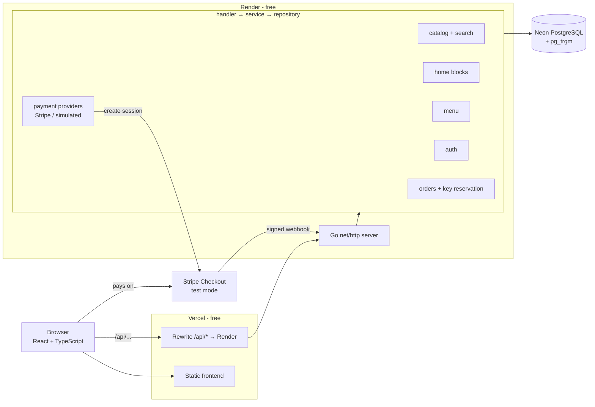

# Eneba-style game key marketplace — internship assignment 2027

A marketplace for digital game keys in the style of [eneba.com](https://www.eneba.com): browse and
search the catalog, compare offers from several sellers, pay (Stripe test mode) and receive the key.

| | |
|---|---|
| **Live app** | **https://eneba-seven.vercel.app** |
| **Code** | https://github.com/Jokubas-J/Eneba (one repository: `frontend/` and `backend/`) |
| **AI conversation logs** | [`ai-logs/`](ai-logs/) — every prompt and response, exported automatically ([how](ai-logs/README.md)) |
| **Pay with** | Stripe test card **4242 4242 4242 4242**, any future expiry date, any CVC. No real money moves. |
| **Account** | Register with any e-mail address (it is not verified). |
| **First visit** | The API runs on a free server that sleeps when idle. The first load after a quiet period can take up to a minute; the page says so ("Waking up the server…") and loads by itself. |

Not affiliated with or endorsed by Eneba. Game titles, descriptions and cover images come from the
[Steam store](https://store.steampowered.com) and belong to their owners; sellers, prices, stock and
keys are invented demo data (see [Data](#6-data-model-and-where-the-data-comes-from)).

---

## 1. What you can do in it

- **Homepage** built entirely from the backend: banner mosaic, *Best sellers*, *Biggest discounts*,
  *New releases* (draggable carousels), *Categories*. Which blocks exist, their order and their data
  all come from the API.
- **Search from every page**: an instant dropdown (query suggestions + product rows) that copes with
  typos and partial names (`witchr 3`, `mincraft`, `gta`, `rdr2`), "Trending searches" before you
  type, Enter → the store with the results.
- **Store**: filters for platform, region, genre, product type and price with live counts, eight sort
  orders, pagination; all state in the URL (shareable, back button works). On phones the filters
  open in a drawer.
- **Categories menu**: a drawer with platforms, genres, regions (live counts), price ranges and
  deals, served by the backend.
- **Product page**: offer comparison (one row per seller: price, discount, rating, stock; the
  cheapest *in-stock* offer is highlighted), screenshot gallery with lightbox, description,
  activation guide per platform, other editions.
- **Cart** in the browser (works before signing in), re-priced by the server.
- **Checkout**: sign in → keys reserved → Stripe Checkout (test mode) or a simulated payment page →
  the order page shows the keys → order history.

---

## 2. Scope: what is deep, what is minimal, and why

The brief says *"a few features done extensively beat many fitting minimal requirements"*, so every
required part exists and works, but the effort is deliberately uneven (full reasoning in
[`PLAN.md`](PLAN.md) §1).

| Gone deep | Why |
|---|---|
| **A. Search + store** | The first thing a visitor touches, three of the seven listed parts, and what Eneba does best. Real SQL and API design: trigram matching, a tested ranking, synonyms, facet counts. |
| **B. Offers and key delivery** | The core risk of a real key marketplace: money + limited inventory + concurrency. Correctness here can be *proven* with tests (two buyers, one key; duplicate webhooks; expiry). |
| **C. Eneba look + backend-driven homepage** | "Looks like eneba.com" is in the first sentence of the brief, and "each block from its own service, nothing hardcoded" is its most unusual architectural requirement. |

| Kept minimal (but complete) | Left out on purpose |
|---|---|
| Accounts: register, sign in, sign out, protected checkout and history | E-mail verification, password reset, social login, 2FA ([why](docs/auth.md)) |
| Order history: orders and their keys | Refunds, invoices, e-mailing keys |
| Cart: in the browser, validated by the server | Server-side cart across devices |

**Out of scope:** seller dashboard and admin UI (content is edited in the database), wishlist,
cashback, reviews, multiple currencies and languages, discount codes, real e-mails. No fake reviews
or counters were invented.

### How the vague points of the brief were interpreted

The full list with the alternatives is in [`docs/requirements.md`](docs/requirements.md) §5; the main ones:

| Vague point | Interpretation |
|---|---|
| "Each block from **its own backend service or database**" (V1) | One backend; each block has its own endpoint, its own query and data source, and fails on its own. Separately deployed microservices would mean five sleeping free-tier servers and change nothing for the visitor. |
| "**Nothing hardcoded**" (V2) | Not only the data: which blocks exist, their order and titles come from the `home_blocks` table. The same pattern drives the menu (`menu_sections`), banners and icons. |
| "Cope with **typos and partial names** where it can" (V3) | PostgreSQL `pg_trgm` word similarity + prefix/whole-word matching + synonyms, with a table of test queries ([`docs/search.md`](docs/search.md)). |
| What is a **product**? (V5) | A sellable variant: game + platform + region, as on Eneba ("Elden Ring Steam Key GLOBAL"). |
| "**Pay**" (V7) | Both: Stripe Checkout in test mode, and a simulated provider behind the same interface (`PAYMENT_PROVIDER=stripe\|simulated`). |
| Where do **keys** come from? (V9) | A pre-loaded stock of keys per offer, each sold exactly once — the real marketplace problem. |
| **Cart** before or after sign-in? (V10) | Before: the cart is in the browser; sign-in is asked for at checkout, as in the brief's flow diagram. |

---

## 3. Architecture



- **One origin for the browser.** Vercel proxies `/api/*` to the Go server, so the session cookie is
  first-party and there is no CORS to configure.
- **Backend layering**, the same in every package: `handler` (HTTP ↔ JSON, validation) → `service`
  (rules) → `repository` (hand-written SQL with pgx). Go standard library `net/http`, no framework,
  no ORM; dependencies are wired explicitly in `cmd/server/main.go`.
- **Migrations** (goose, embedded in the binary) run when the server starts.
- **Homepage contract** — `GET /api/home` returns the block list; the frontend has one map
  *block type → component* and fetches each block's `source` separately
  ([`docs/homepage.md`](docs/homepage.md)).
- **Purchase sequence** — reserve keys → payment session → webhook or return page confirms →
  keys sold → order page ([`docs/checkout.md`](docs/checkout.md)).

| Layer | Choice | Why (details in [`docs/research.md`](docs/research.md)) |
|---|---|---|
| Frontend | React 19, TypeScript, Vite, React Router, TanStack Query, Tailwind CSS | Brief asks for React; TanStack Query gives every homepage block its own loading/error state; Tailwind theme tokens hold the measured Eneba design |
| Backend | Go, `net/http`, pgx | Go was allowed; the standard router is enough for 23 routes; hand-written SQL keeps search and locking visible |
| Database | PostgreSQL on Neon | `pg_trgm` for fuzzy search, row locks for key reservation, free branches for dev/test/prod |
| Payments | Stripe Checkout (test mode) | Hosted payment page: no card data touches our server |
| Hosting | Vercel + Render + Neon | Free tiers; the trade-off is Render's cold start |

---

## 4. Key decisions and their downsides

| Decision | Alternative | Why this one | Downside accepted |
|---|---|---|---|
| **Go** | PHP | Explicit concurrency and transactions, one static binary, fast tests | More code for things a PHP framework gives for free |
| **REST** | GraphQL (Eneba uses it) | Few, fixed screens; each homepage block is naturally one URL; simpler to cache and test | The frontend sometimes makes several requests per page |
| **Postgres `pg_trgm`** | Meilisearch / Typesense | No extra service to host and sync; ~500 products; ranking is explainable SQL ([comparison](docs/search.md#should-we-switch-to-meilisearch-or-typesense)) | Would not scale to millions of products or offer instant faceting at that size |
| **Server sessions (cookie)** | JWT | Logout and expiry really work (the row is deleted); `HttpOnly` cookie is out of reach of scripts | A database lookup per request |
| **Modular monolith** | Microservices per homepage block | Blocks still fail independently (separate endpoints and queries) | One deployment: a server crash takes all blocks down |
| **Browser cart** | Server cart | Works before sign-in, as in the brief's flow; the server re-prices it anyway | Not shared between devices |
| **Stripe + simulated** | Only one | Stripe is the real thing; the simulated provider makes tests and the demo independent of Stripe | Two paths to maintain behind one interface |
| **Reserve keys at checkout** | Assign keys in the webhook | A buyer learns "sold out" *before* paying, never after | Keys are held for up to 30 minutes by people who do not pay (limited per user, see below) |

---

## 5. How key delivery is made safe

A key must never be sold twice, never be delivered twice, and nobody may pay without getting one.
Details and the full failure table: [`docs/checkout.md`](docs/checkout.md).

1. **Reservation in one transaction.** Checkout reads every price from the database (the request
   has no price field), then reserves the keys with
   `SELECT … FOR UPDATE SKIP LOCKED`: two buyers can never get the same key, and neither waits for
   the other. If any line is short, the whole order is rolled back.
2. **The payment session expires with the reservation** (30 minutes), so Stripe cannot take money
   after the keys could have been released. Only card payments, which confirm instantly.
3. **Idempotent fulfilment.** `UPDATE orders SET status = 'paid' … WHERE status = 'pending'`
   succeeds for exactly one caller; the webhook and the return page can both try, any number of
   times. Each Stripe event is stored with a unique id in the same transaction as its effect.
4. **Verified webhooks.** The Stripe signature (HMAC of the raw body) is checked before anything
   else; old events are refused.
5. **Expiry.** Unpaid orders release their keys on Stripe's `expired` event or via a clean-up job
   every minute.
6. **Fair use.** At most 3 unpaid orders and 20 reserved keys per user, so one account cannot hold
   the stock.
7. **Environments.** Dev and production share one Stripe test account; idempotency keys are random
   per order and sessions carry the environment, so they cannot collide (a bug the author found on
   the live site, [journal](docs/journal.md)).

| Proven by | What it shows |
|---|---|
| `TestRaceForTheLastKey` | 20 buyers at once for 1 key → exactly 1 order, 19 "out of stock" |
| `TestDuplicateWebhook`, `TestConcurrentFulfilment` | The same payment confirmed 10 times at once → keys sold once |
| `TestExpiryReleasesKeys`, `TestExpiredOrderCannotBePaid` | Abandoned payments return their keys; a late payment never delivers |
| `TestCheckoutIgnoresPricesFromTheBrowser` | A tampered price is ignored |
| `TestStripeWebhookSignature` | Forged, replayed or altered webhooks are refused |
| `TestPendingOrderLimits` | The per-user limits hold, even for parallel requests |
| `TestOrdersAreOnlyVisibleToTheirOwner` | Another user's order and keys are a 404 |

---

## 6. Data model and where the data comes from

**Steam store data, fetched once.** A seed script downloaded the public store details of 236 games
(`go run ./cmd/seed fetch`) into a committed snapshot, [`backend/seed/steam_games.json`](backend/seed/steam_games.json).
The running app **never calls Steam**; cover and screenshot images are hot-linked from Steam's CDN.
**Thank you, Steam** — titles, descriptions, genres, release dates, developers, popularity
(recommendation counts) and images are real Steam data.

**Synthetic** (generated with a fixed random seed, so every load is identical): platform and region
variants, 12 sellers and their ratings, 1,648 offers with prices around Steam's price, and 11,414
license keys (`DEMO-XXXXX-XXXXX-XXXXX`, they activate nothing).

Main tables ([`backend/internal/database/migrations`](backend/internal/database/migrations)):

| Table | Holds |
|---|---|
| `products` | One sellable variant (game + platform + region), with generated search columns |
| `offers`, `sellers` | One seller's price for a product |
| `license_keys` | Key stock: `available` → `reserved` (order line, expiry) → `sold` |
| `orders`, `order_items` | Orders with price snapshots; `payment_events` stores processed Stripe events |
| `users`, `sessions` | Accounts (Argon2id hashes) and hashed session tokens |
| `home_blocks`, `banners`, `menu_sections`, `menu_links`, `taxonomy_icons` | Homepage, menu and icons as data |
| `search_suggestions`, `search_synonyms` | Curated and visitor query suggestions; synonyms (`gta` → grand theft auto, `rdr` → red dead redemption, `5` ↔ `v`) |

To add a game: its Steam app id in `backend/seed/app_ids.txt` → `seed fetch` → `seed load`
([`docs/setup.md`](docs/setup.md) §6).

---

## 7. Running it locally

**Needs:** Go 1.27, Node.js 24, a free [Neon](https://neon.tech) project with three branches
(`main` = production, `dev`, `test`), optionally the [Stripe CLI](https://docs.stripe.com/stripe-cli).
No Docker. Every variable is explained in [`docs/setup.md`](docs/setup.md) §3.

```powershell
# Backend
cd backend
copy .env.example .env            # then fill in DATABASE_URL (dev branch) and TEST_DATABASE_URL (test branch)
go run ./cmd/seed load            # creates the tables and loads the catalog
go run ./cmd/server               # http://localhost:8080 (applies migrations on start)

# Frontend (second terminal)
cd frontend
npm ci
npm run dev                       # http://localhost:5173, proxies /api to the Go server
```

**Payments.** With `PAYMENT_PROVIDER=simulated` (the default) "Pay" is a button on our own page.
For Stripe test mode:

1. Put your test secret key into `backend/.env`: `STRIPE_SECRET_KEY=sk_test_…` (live keys are refused).
2. `stripe login`, then keep `stripe listen --forward-to localhost:8080/api/webhooks/stripe` running.
3. Copy the `whsec_…` it prints into `backend/.env` as `STRIPE_WEBHOOK_SECRET`, set
   `PAYMENT_PROVIDER=stripe`, restart the server, pay with 4242 4242 4242 4242.

**Tests** (the database tests use only `TEST_DATABASE_URL`, never dev or production):

```powershell
cd backend;  go test -p 1 ./...    # unit + database tests (one package at a time: they share the test branch)
cd frontend; npm test              # Vitest: logic and component tests
cd frontend; npm run e2e           # Playwright: search with a typo → buy → key → order history
```

GitHub Actions runs the Go and frontend tests, lint and build on every push (with its own temporary
PostgreSQL).

---

## 8. How AI was used

I built this with **Claude Code** (Anthropic). The complete conversation — every prompt, answer and
tool call — is in [`ai-logs/`](ai-logs/), exported by a hook after every turn
([`ai-logs/README.md`](ai-logs/README.md)); tools and plugins are listed in
[`docs/tooling.md`](docs/tooling.md).

**Workflow.** Plan first, then small steps:

1. Day 1: requirements checklist, research, a design reference measured from eneba.com, and
   [`PLAN.md`](PLAN.md), which I reviewed and approved before any code.
2. Each day: I gave the goal and constraints; the AI proposed options for real choices
   (libraries, data sources, architecture) with a recommendation, **I decided**; it then
   implemented in small commits, explaining what each part does and why, and stopped at agreed
   checkpoints so I could review in the browser.
3. Project rules in [`CLAUDE.md`](CLAUDE.md): no secrets in chat or git, tests before "it works",
   explain every non-trivial piece, commit small, never rewrite history.

**Decided by me** (examples): Go, Neon without Docker, Stripe *plus* a simulated provider, Steam as
the data source; keys reserved at checkout; the table-driven Categories menu (option B); "Best
sellers" from real sales only, no invented order history; Steam hero art for banners; no magic-link
or social login; no fake reviews or counters.

**Where I corrected or rejected the AI's output** (examples):

- I found the Stripe **idempotency-key collision** myself while testing the live site with a real
  cart; the AI then wrote a failing test reproducing it before fixing it.
- It first gave every category tile the **same icon**; I asked for icon keys stored in the
  database and an icon library instead.
- Visual feedback from my own testing: carousels and their scrollbar were **not draggable**, the
  header **wrapped** with a long e-mail, narrow banners showed **a sliver** of the picture, the
  search box showed **nothing before typing** (Eneba shows trending searches), and **loading
  states and transitions** were missing. All fixed and verified in the browser.
- The scope of the product page: I insisted the offer comparison be deep, not minimal.

**Mistakes the AI made and caught** are recorded honestly in [`docs/journal.md`](docs/journal.md)
(e.g. an edited applied migration, a test fixture that deleted every key, a focus bug after
animating dialogs).

---

## 9. Known limitations and what I would do next

- **Cold start**: the free Render server sleeps; the first request after a pause takes up to a
  minute (the app shows a notice and retries).
- **Search** is PostgreSQL trigrams: fine for hundreds of products; a search engine (Meilisearch)
  for a real catalog.
- **No e-mails**: no verification, password reset or keys by e-mail.
- **No admin UI or seller side**: banners, homepage blocks and the menu are edited in the database.
- **No refunds** or cancellations; a payment after an order expired is only logged for a manual
  refund (Stripe makes it practically impossible).
- **Simple rate limits** (in memory per e-mail for login, site-wide for sign-up); a real shop would
  use a shared store and CAPTCHA. Security review: [`docs/security.md`](docs/security.md).
- **EUR and English only**; no i18n.

## Documentation

| | |
|---|---|
| [`PLAN.md`](PLAN.md) | Scope, architecture, data model, API, the 7-day plan, decisions |
| [`docs/requirements.md`](docs/requirements.md) | The brief as a checklist, with interpretations |
| [`docs/journal.md`](docs/journal.md) | Day by day: built, verified, mistakes, bugs |
| [`docs/search.md`](docs/search.md) · [`docs/homepage.md`](docs/homepage.md) · [`docs/checkout.md`](docs/checkout.md) · [`docs/auth.md`](docs/auth.md) · [`docs/security.md`](docs/security.md) | Each deep part: design, decisions, failure cases, tests |
| [`docs/design-reference.md`](docs/design-reference.md) · [`docs/gap-analysis.md`](docs/gap-analysis.md) | Measured Eneba design; comparison with eneba.com |
| [`docs/research.md`](docs/research.md) · [`docs/tooling.md`](docs/tooling.md) · [`docs/setup.md`](docs/setup.md) | Technology choices; AI tools and libraries; accounts and variables |
